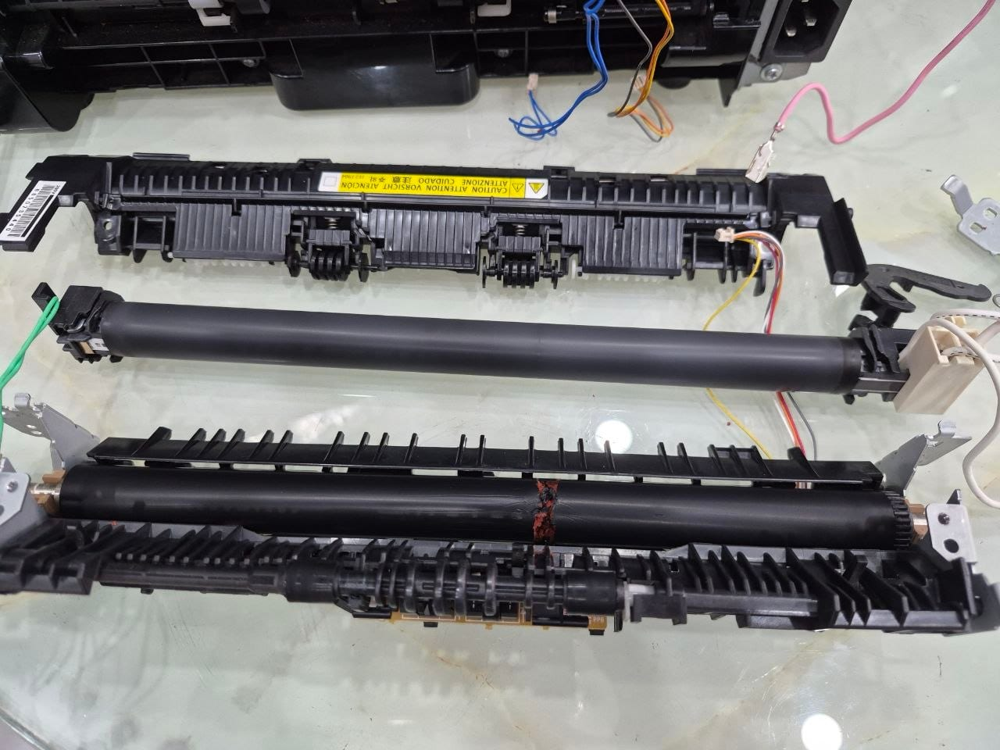
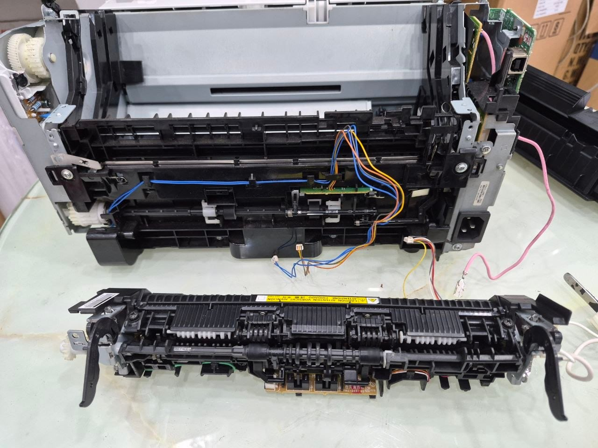
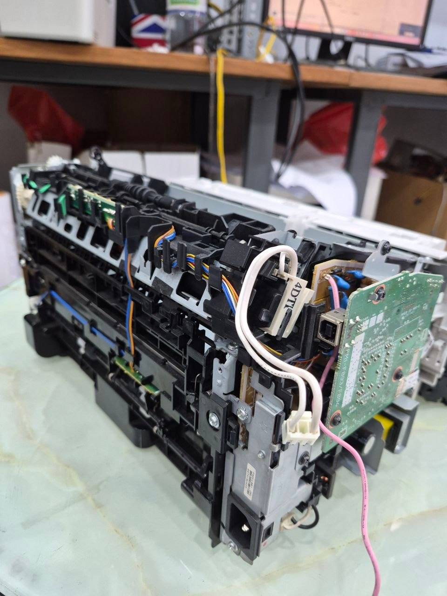
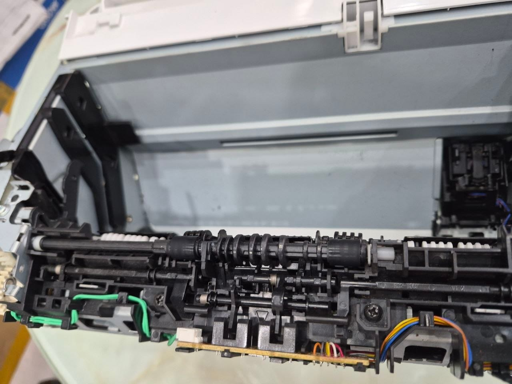

Máy in Canon 6030 là dòng máy laser phổ biến, thường được dùng trong các văn phòng nhỏ hoặc gia đình. Chi nhánh Tô Ký, Quận 12 của chúng tôi vừa tiếp nhận một máy Canon 6030 gặp sự cố ở bộ phận sấy, cụ thể là hư trục ép và bao lụa.

## Tình trạng máy
Khi kiểm tra, kỹ thuật viên phát hiện máy in Canon 6030 này có các dấu hiệu sau:
*   Bản in bị lem mực, chữ không bám chắc vào giấy hoặc bị nhòe.
*   Giấy in bị kẹt thường xuyên ở khu vực bộ phận sấy.
*   Kiểm tra trực quan cho thấy bao lụa (fuser film) bị rách hoặc biến dạng, trục ép (pressure roller) có thể bị mòn hoặc hư hỏng bề mặt.

Các linh kiện này thuộc bộ phận sấy (fuser unit), có vai trò quan trọng trong việc làm nóng và ép mực bám chặt vào giấy. Khi chúng hỏng, chất lượng bản in sẽ bị ảnh hưởng nghiêm trọng.

## Nguyên nhân
Trục ép và bao lụa là hai bộ phận chịu nhiệt và ma sát cao trong quá trình in ấn. Một số nguyên nhân phổ biến dẫn đến hư hỏng bao lụa và trục ép bao gồm:
*   **Tuổi thọ linh kiện:** Sau một thời gian dài sử dụng, các linh kiện này sẽ bị hao mòn tự nhiên.
*   **Sử dụng giấy kém chất lượng:** Giấy quá mỏng, quá dày, hoặc có bụi giấy nhiều có thể làm rách bao lụa hoặc làm mòn trục ép nhanh hơn.
*   **Vật lạ rơi vào máy:** Kim bấm, kẹp giấy hoặc các vật nhỏ khác có thể mắc kẹt và gây rách bao lụa.
*   **Nhiệt độ hoạt động không ổn định:** Có thể do lỗi từ các cảm biến nhiệt hoặc bộ phận điều khiển nhiệt độ.

## Cách xử lý
Để khắc phục lỗi này, kỹ thuật viên của chúng tôi đã tiến hành các bước sau:
*   **Tháo rời bộ phận sấy:** Máy in được tháo vỏ và các bộ phận liên quan để tiếp cận cụm sấy.
*   **Kiểm tra và xác định linh kiện hỏng:** Bao lụa bị rách rõ rệt, trục ép cũng có dấu hiệu mòn cần thay thế.
*   **Thay thế linh kiện mới:** Trục ép và bao lụa mới, chính hãng hoặc tương đương chất lượng cao, được lắp đặt vào cụm sấy.

*   **Vệ sinh tổng thể:** Các bộ phận khác bên trong máy cũng được vệ sinh sạch sẽ, đặc biệt là khu vực đường đi của giấy.
*   **Lắp ráp lại và kiểm tra:** Sau khi thay thế, máy được lắp ráp lại hoàn chỉnh và chạy thử nhiều bản in để đảm bảo chất lượng và độ ổn định.
 
Việc thay thế linh kiện kịp thời giúp máy in Canon 6030 hoạt động ổn định trở lại, đảm bảo chất lượng bản in sắc nét như ban đầu.

## Lưu ý khi sử dụng
Để kéo dài tuổi thọ của máy in và các linh kiện như trục ép, bao lụa, người dùng nên:
*   Sử dụng loại giấy in phù hợp với khuyến nghị của nhà sản xuất.
*   Tránh để các vật lạ rơi vào khay giấy hoặc bên trong máy in.
*   Thực hiện vệ sinh và bảo dưỡng định kỳ cho máy in.
*   Liên hệ dịch vụ sửa chữa chuyên nghiệp ngay khi phát hiện các dấu hiệu bất thường về chất lượng bản in hoặc tiếng ồn lạ từ máy.
