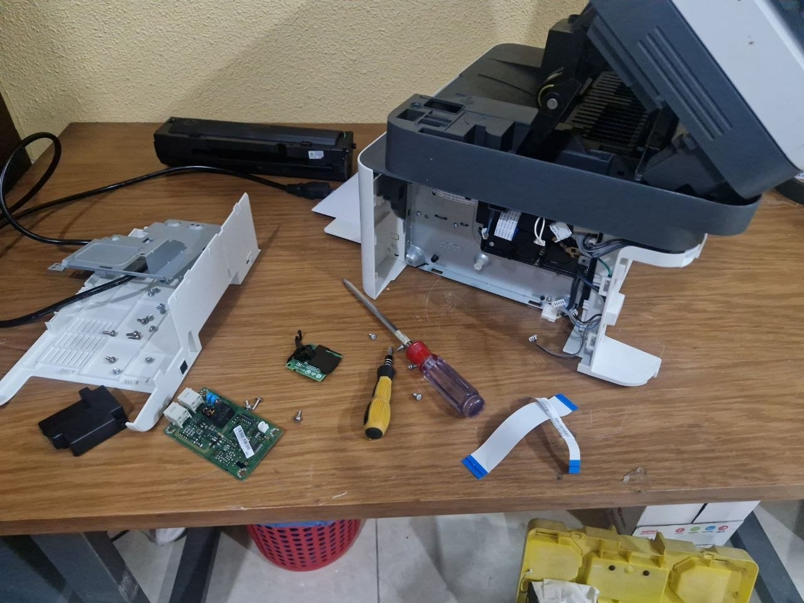
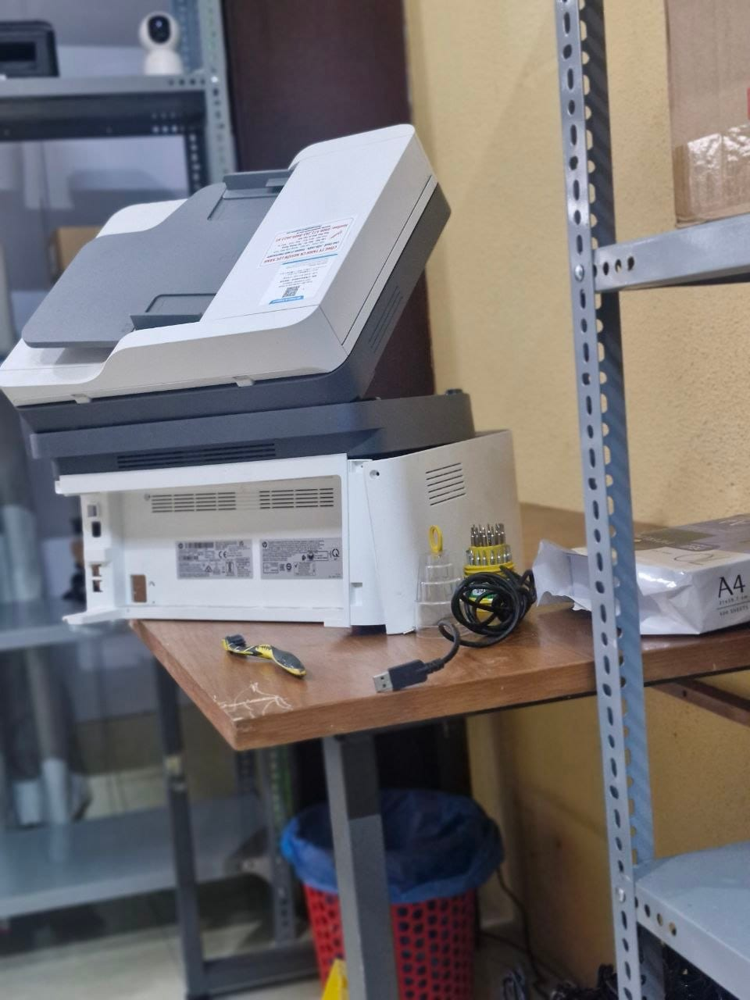

Máy in HP 139nfw là một dòng máy in đa chức năng phổ biến trong văn phòng. Gần đây, chi nhánh Tô Ký, Quận 12 của chúng tôi đã tiếp nhận một trường hợp máy in HP 139nfw bị mất nguồn hoàn toàn, không thể khởi động. Đây là tình trạng thường gặp nếu máy không được sử dụng và bảo quản đúng cách.

## Tình trạng máy
Máy in HP 139nfw không có dấu hiệu hoạt động khi cắm điện. Đèn nguồn không sáng, màn hình không hiển thị bất kỳ thông báo nào.

## Nguyên nhân gây mất nguồn
Sau khi kiểm tra, kỹ thuật viên của chúng tôi phát hiện nguyên nhân gây mất nguồn là do có thằn lằn đã chui vào bên trong máy trong quá trình máy được để ở kho. Côn trùng chui vào có thể gây chập mạch, làm hỏng các linh kiện điện tử nhạy cảm, đặc biệt là bo nguồn. Bo nguồn bị hỏng sẽ khiến máy không nhận được điện áp cần thiết để hoạt động.

## Cách xử lý sự cố
Để khắc phục tình trạng này, kỹ thuật viên đã thực hiện các bước sau:
*   Tháo rời các bộ phận của máy in để tiếp cận bo nguồn.
*   Kiểm tra kỹ lưỡng bo nguồn và các linh kiện liên quan, xác định chính xác vị trí chập cháy hoặc hỏng hóc do côn trùng.
*   Tiến hành thay thế bo nguồn mới, đảm bảo tương thích với máy HP 139nfw.
*   Lắp ráp lại các bộ phận của máy in một cách cẩn thận.
*   Kiểm tra lại toàn bộ chức năng của máy sau khi thay thế, đảm bảo máy hoạt động ổn định và không còn lỗi mất nguồn.

## Lưu ý khi bảo quản máy in
Để tránh những sự cố tương tự, người dùng nên lưu ý một số điểm khi bảo quản máy in, đặc biệt là khi không sử dụng trong thời gian dài:
*   Đặt máy in ở nơi khô ráo, thoáng mát, tránh ẩm ướt và bụi bẩn.
*   Sử dụng vỏ bọc hoặc che chắn máy in cẩn thận để ngăn côn trùng như thằn lằn, gián, chuột chui vào bên trong.
*   Nếu máy để kho lâu ngày, nên vệ sinh định kỳ và kiểm tra sơ bộ trước khi đưa vào sử dụng lại.
